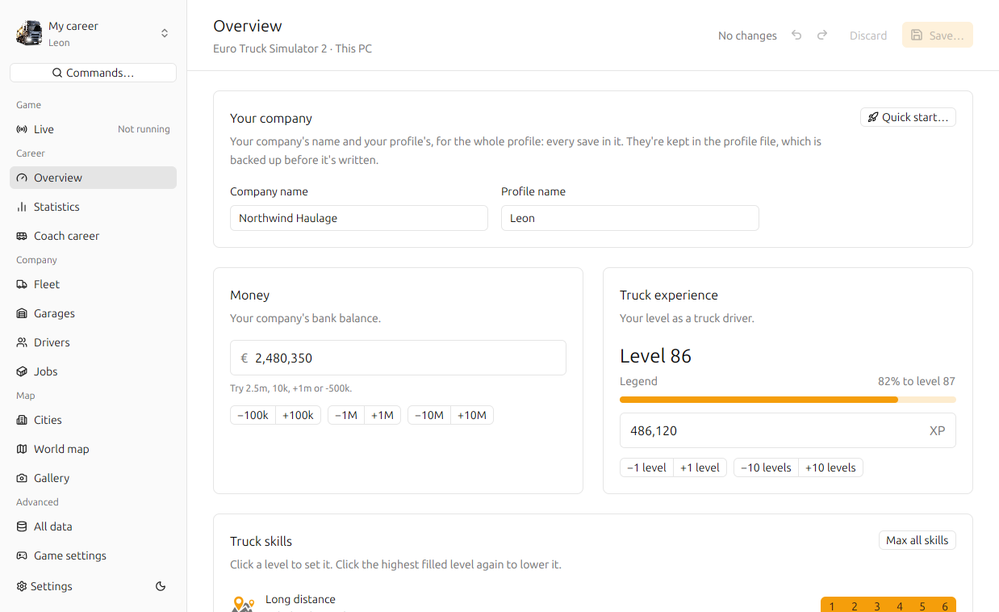
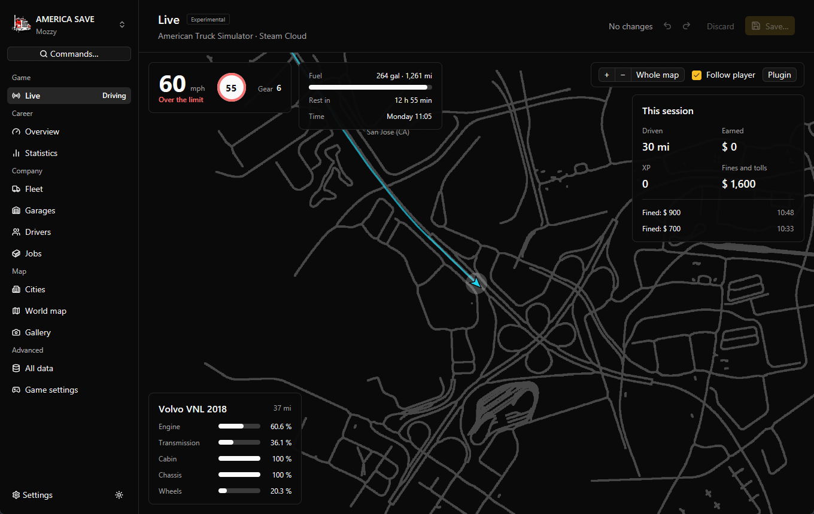
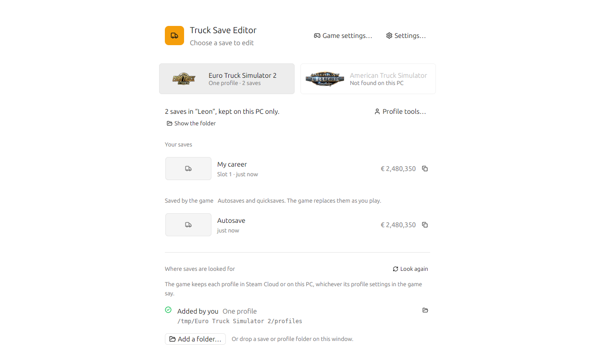
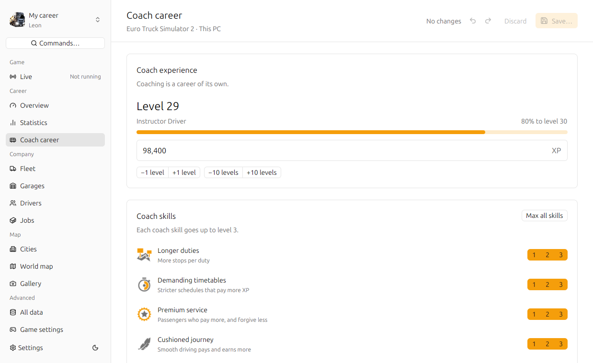
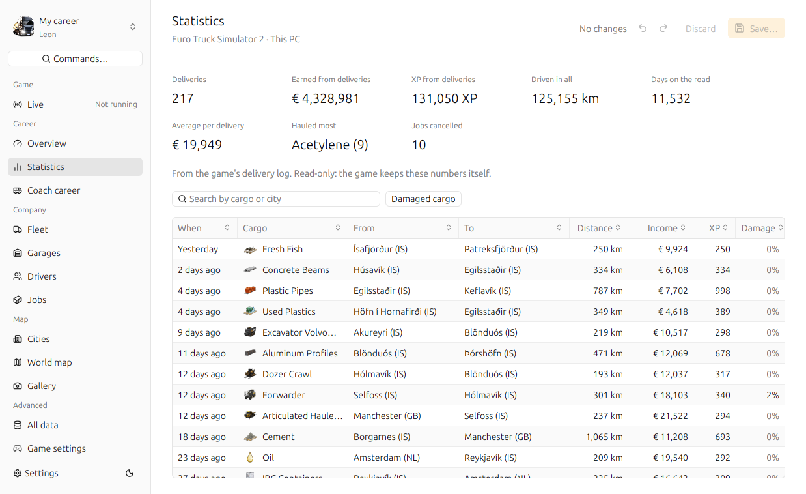
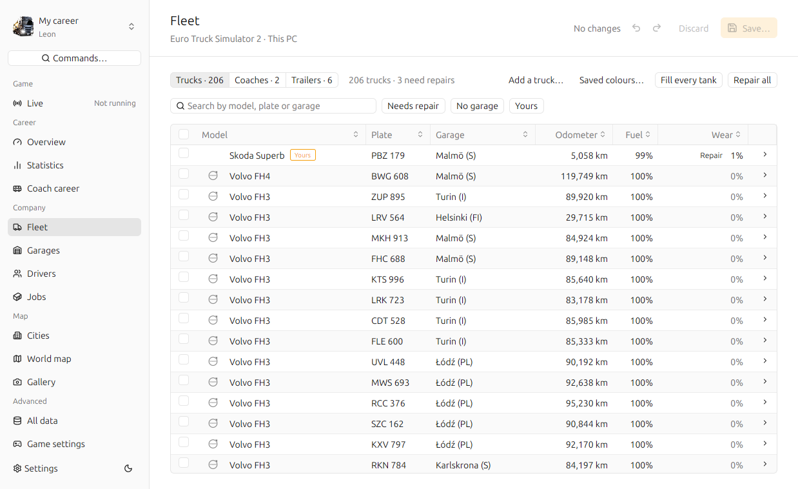
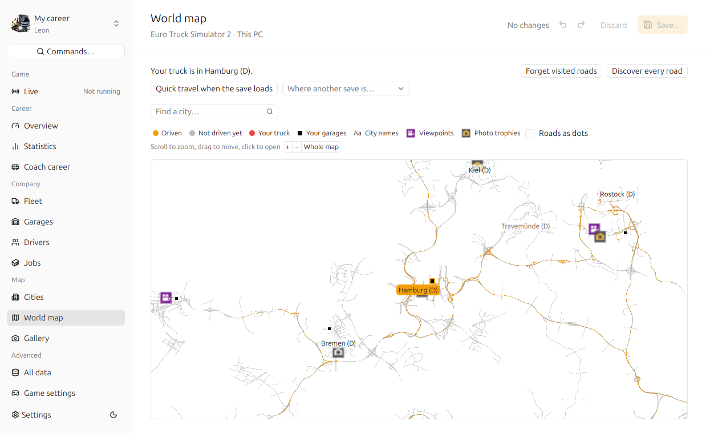
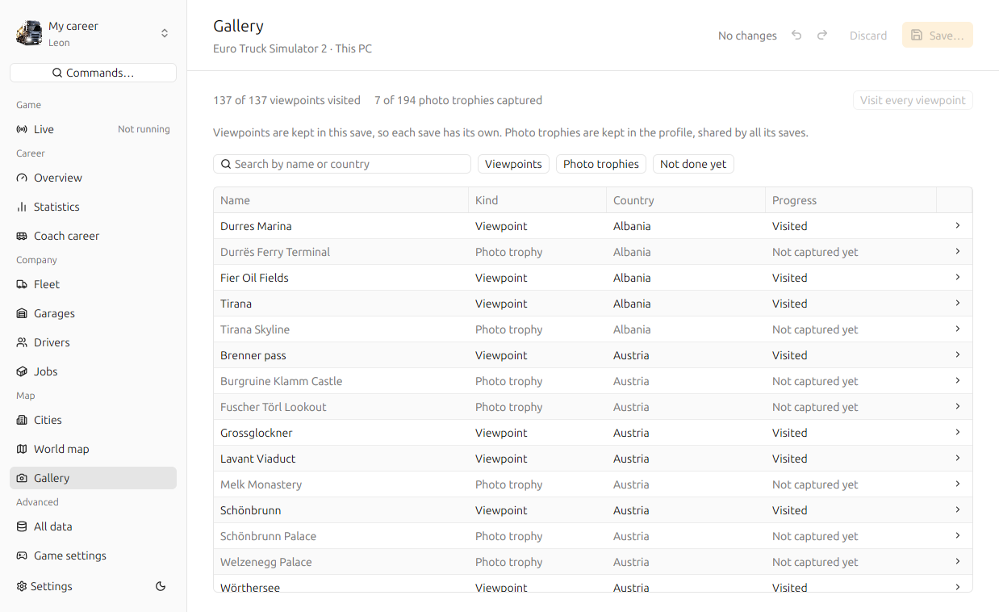
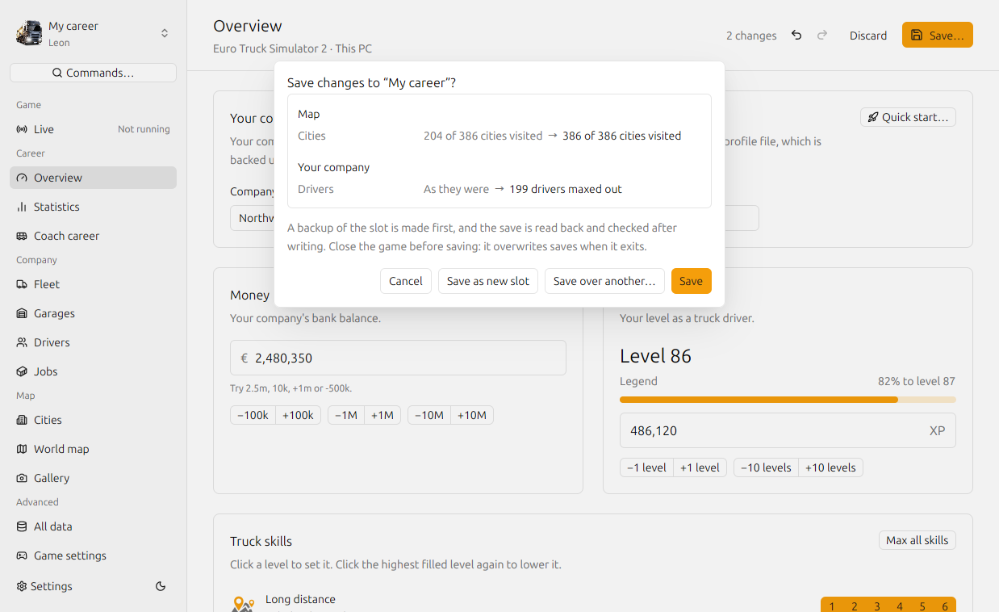

# Truck Save Editor

A save editor for **Euro Truck Simulator 2** and **American Truck Simulator**: fast, safe and pleasant to use. Change your money and level, your fleet and drivers, your garages and the map, see every road you've driven, and never lose a save doing it.

<picture>
  <source media="(prefers-color-scheme: dark)" srcset="docs/screenshots/overview-dark.png">
  
</picture>

> **Early version.** Most features have been checked in the game (on a Steam Cloud profile, in the current game version); every save is backed up before it's written, and a backup is one click to restore. Both games are supported, each with its own data (ATS's map, cities, cargo, miles and dollars).

## Download

Get the latest version from [Releases](https://github.com/leonlarsson/truck-save-editor/releases): download the `.exe` and run it (Windows 10 or 11, nothing to install). It isn't code-signed yet, so Windows may show "Windows protected your PC" at first: choose **More info**, then **Run anyway**. Each release lists checksums, and its files can be checked with `gh attestation verify` (see the release notes).

The editor tells you when a newer version is out: when it starts, it asks GitHub for the latest release (turn that off in Settings). That is the only time it uses the internet, and nothing about you or your saves is sent.

## What it does

### Live: your drive as it happens (experimental)

- **The game on the map while you play**: where you are, the way you're heading, the road you've driven this session behind you, and a flag on your job's destination.
- **Your drive in numbers**: speed against the limit, gear, fuel and range, rest, the game's clock, and your vehicle's wear.
- **Your job** along the foot of the map, with how far is left and when it's due; **this session** in totals (driven, earned, XP, fines and tolls) with what just happened.
- It works through a small plugin for the game's own SDK, which the editor adds to the game's folder when you ask and removes again at any time. It only reads, and nothing leaves your PC. Both games, in each one's units.

### Finding your saves

- Pick the game first (Euro Truck Simulator 2 or American Truck Simulator, each with its logo from your install), then the profile.
- Finds Steam Cloud and local profiles by itself, with each profile's name, and every save with when it was saved and its money; your own saves first, the game's autosaves folded below.
- Says which profile's saves it shows and where they're kept, with a button to open the folder, and lists every place it looked and what each held.
- Saves somewhere else (a backup, another drive) can be added: choose the folder or drop it on the window. A single save on its own opens where it is.
- Warns about a save that needs DLCs or mods you don't have installed.
- **Duplicate** a save, unchanged, into a new slot (local profiles: on Steam Cloud the game only lists saves it wrote itself).
- **Profile tools**: back up a whole profile, make a copy of it under a new name (without its World of Trucks login), or copy its game settings (controls, gameplay options) over another profile's.

<picture>
  <source media="(prefers-color-scheme: dark)" srcset="docs/screenshots/start-dark.png">
  
</picture>

### Your career

- Money, with shortcuts (2.5m, +1m, −500k).
- Truck experience, shown as a level with the game's own rank name; set a level directly or step it.
- Every truck skill, and ADR classes, with Max all.
- Your headquarters city, your company's name and the profile's name.
- **Your day**: rest (no tiredness, no break due), clear your police record, repair the cargo you're carrying, and set the clock to the morning, noon, evening or night.
- **Quick start** for a fresh career: a rich start, everything unlocked, or your own picks, in one go.
- **DLC and mods**: what the save was made with, and whether each is installed.

### Coach career

A page of its own, for saves with a coach career:

- Coach experience as a level with the game's rank name, and every coach skill, with Max all.
- Coach services as the game's statistics show them: set the passengers transported and the coach distance, make every service's passengers fully satisfied, or discover every bus stop.
- Every coach service from the game's log, newest first: where from and to, passengers, satisfaction, distance, pay and XP.

<picture>
  <source media="(prefers-color-scheme: dark)" srcset="docs/screenshots/coach-career-dark.png">
  
</picture>

### Statistics

- Your truck career in numbers: deliveries, money and XP earned from them, distance driven, days on the road, the average delivery, the cargo you hauled most, jobs cancelled.
- Every delivery from the game's delivery log, newest first, to sort, search, and filter to damaged cargo.

<picture>
  <source media="(prefers-color-scheme: dark)" srcset="docs/screenshots/statistics-dark.png">
  
</picture>

### Fleet: trucks, coaches and trailers

- Every truck, coach and trailer, with its garage, odometer, fuel and wear; your own truck and trailer tagged and listed first, with filters for needs repair, no garage and yours.
- Paint: change a truck's or trailer's paint job from the game's own list, and its colours; edit the colours saved in the game's paint screen, and share them as text.
- Repair one part or everything, or drag a part's wear to any level; fill the tank (or past full), Repair all and Fill every tank.
- Move a truck to another garage (its driver goes with it), or remove it.
- Swap a truck's engine and transmission for others of its model, from the game's own parts.
- Change the plate's text, colour the plate (white on blue, gold on black …), remove the side badge, set the odometer.
- Make another truck yours (**Drive it yourself**), or another trailer the one you pull.
- Trailers: cargo and empty weight, and the countries it may enter (or everywhere).
- Pick several rows to repair, refuel, move or remove them together.

<picture>
  <source media="(prefers-color-scheme: dark)" srcset="docs/screenshots/fleet-dark.png">
  
</picture>

### Garages and drivers

- Every garage: buy them all, make them large, change the headquarters, remove empty ones; pick several to make them large or remove them.
- Every hired driver, with their face, hometown, where they are now, their truck, experience, skills and ADR: max one or all, move them to another garage (their truck goes with them), or remove them.

### The map: Cities, World map, Gallery

- **Cities**: every city of the game, counted as the game counts them, whether you've been there, and its truck dealer and recruitment agency. Visit every city, unlock every dealer and agency, or open one city to visit it (or not), unlock or lock its dealer or agency, open its garage, or show it on the map.
- **World map**: every road and junction on the game's map, the ones you've driven highlighted, with city names, your garages, your truck, and the viewpoints and photo trophies in the game's own icons. Zoom with the mouse wheel and drag to move; the legend shows and hides each part. Click a city, a garage, your truck, a viewpoint or a photo trophy to open it, or find a city.
- **Discover every road**: the whole map explored (100 % in game), from the game's own map files. Or **forget visited roads** and start the map over.
- Your position: a free **quick travel** when the save loads (the game lets you pick any city you've visited), or the exact spot from another save of the profile.

<picture>
  <source media="(prefers-color-scheme: dark)" srcset="docs/screenshots/world-map-dark.png">
  
</picture>

- **Gallery**: every viewpoint and photo trophy from the game's own list, with what you've visited and captured, and what's left: visit every viewpoint, or mark one visited or not found. Photo trophies are your own photos, so they're shown, never made up.

<picture>
  <source media="(prefers-color-scheme: dark)" srcset="docs/screenshots/gallery-dark.png">
  
</picture>

### Jobs

- The job you're on: cancel it with no fee, or remove its deadline.
- Every offer on the job market: keep them all for a week.
- Make a job: pick where from, the cargo, where to, the trailer and how urgent, and it's on the freight market when the save loads.

### Game settings

- Where the game is installed, found by itself or chosen.
- The developer console, and convoys of up to 128 trucks, in the game's `config.cfg` (backed up before each change).

### Everything else: All data

- Every unit and value in the save, searchable and editable, with checks so a typo can't break the save.

### Saving, safely

- Every change is listed before saving, grouped by what it belongs to, with its value before and after.

  <picture>
    <source media="(prefers-color-scheme: dark)" srcset="docs/screenshots/save-dark.png">
    
  </picture>

- A backup of the save before every write, kept outside the game's folders; restoring one is a click (and backs up what's there first).
- The save is read back and checked after writing, and nothing is written while the game is running (it overwrites saves when it exits).
- **Save as new slot** keeps the original as it is (local profiles); **Save over another** writes your changes into another save of the profile, which works with Steam Cloud too.
- Undo and redo for every change (Ctrl+Z, Ctrl+Shift+Z), Discard to start over.
- Everything the save doesn't need changed stays exactly as it was, so it keeps working when the game updates.

### The app

- In English, German, Polish and Swedish, with the game's own names (cities, cargo, ranks) in the same language. German and Polish are first drafts that need a native speaker's review; corrections welcome.
- Light and dark, or the system's.
- A **command palette** (Ctrl+K) for every page and bulk action, and the whole app usable from the keyboard: the palette for pages, Ctrl+, for Settings, Ctrl+S to review and save, Enter to open a row.
- Uses the game's own data from your install: level tables, rank names, skill limits, city names, icons, truck parts and the map, so it stays right when the game changes.
- **Report a problem** opens a GitHub issue filled in with what helps; after a crash, the editor offers to report what happened. Nothing is sent without you posting it.
- The save's menu at the top of the sidebar: switch to another save, or restore a backup.
- Settings, the editor's own: the language, light or dark, the backups folder, updates, and resetting them.

## Staying compatible

Game updates change the save format now and then. The editor keeps every part of a save it doesn't understand exactly as it was, stops instead of guessing at anything new, and checks every week whether the game has updated. How, and why, is in [`docs/compatibility.md`](docs/compatibility.md).

## Contributing

Built in Rust with [GPUI](https://www.gpui.rs/) through [GPUI Kit](https://gpui-kit.com). Read [`AGENTS.md`](AGENTS.md) (for humans too), [`docs/sii-format.md`](docs/sii-format.md) for how the game's save files work, and [`docs/decisions.md`](docs/decisions.md) for why things are the way they are.

## License

[MIT](LICENSE). Not affiliated with or endorsed by SCS Software. Euro Truck Simulator 2 and American Truck Simulator are trademarks of SCS Software. The editor reads the game's data from your own install; the only SCS artwork included is each game's own icon, to show which game a save belongs to.
