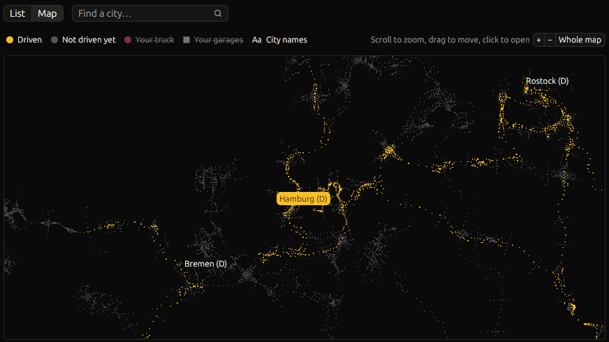
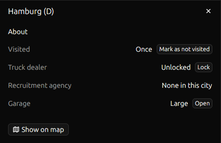
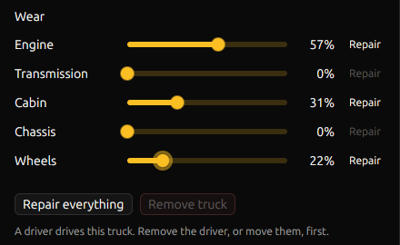
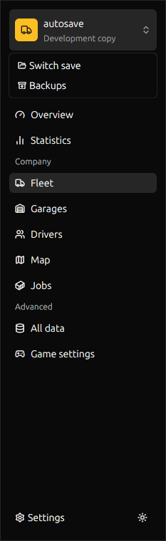

<!-- The notes for 0.2.0, to paste over the drafted ones when publishing v0.2.0. The download and
     checksum sections the workflow adds (.github/release-footer.md) follow them. -->

**Truck Save Editor 0.2.0** makes the map something you can work from, gives every city its own panel, and lets you set each part's wear exactly.

### New

- **Click the map.** A city's name opens the city, a garage opens the garage, and your truck opens your truck. **Find a city…** above the map takes you straight to one.

  
- **A panel for every city:** how often you've been there, its truck dealer and recruitment agency, and your garage there, each with its action beside it. Mark a city as visited or not, unlock a dealer or agency or lock it again, open the garage, or **Show on map**. The list of cities opens the same panel (double-click, Enter, or the › at the end of a row).

  
- **Drag a part's wear** to any level in a truck's or trailer's panel, from like new to worn out. One drag is one step for Undo, and setting the wheels sets them all.

  
- **The garage panel's trucks and drivers** open their own panels.

### Changed

- **The sidebar:** the save's name at the top is now its menu, with **Switch save** and **Backups** (they were at the bottom).

  
- **Game settings**, a page of its own, holds the game's folder and the game's own settings (the developer console and convoy size). **Settings**, at the foot of the sidebar (Ctrl+,), is now only the editor's own: language, appearance, backups, updates. The start screen has both.
- On the Map page, the switch reads **List | Map**.

### Fixed

- One drag or repair of a part's wear counts as one change in the header, as the save dialog lists it, not one per wheel.

Found a problem? **Report a problem** in Settings → About (or on the error message) opens a GitHub issue filled in with what helps.
