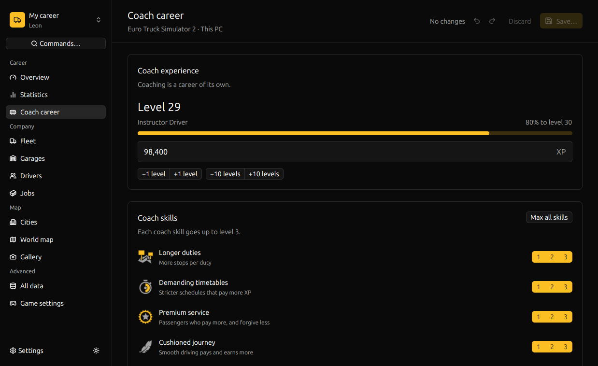
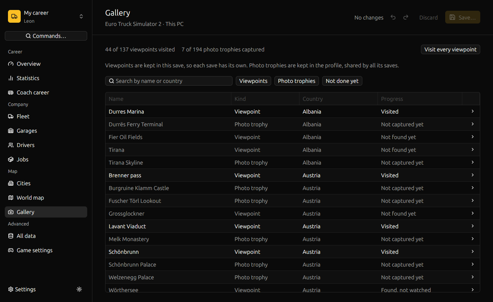
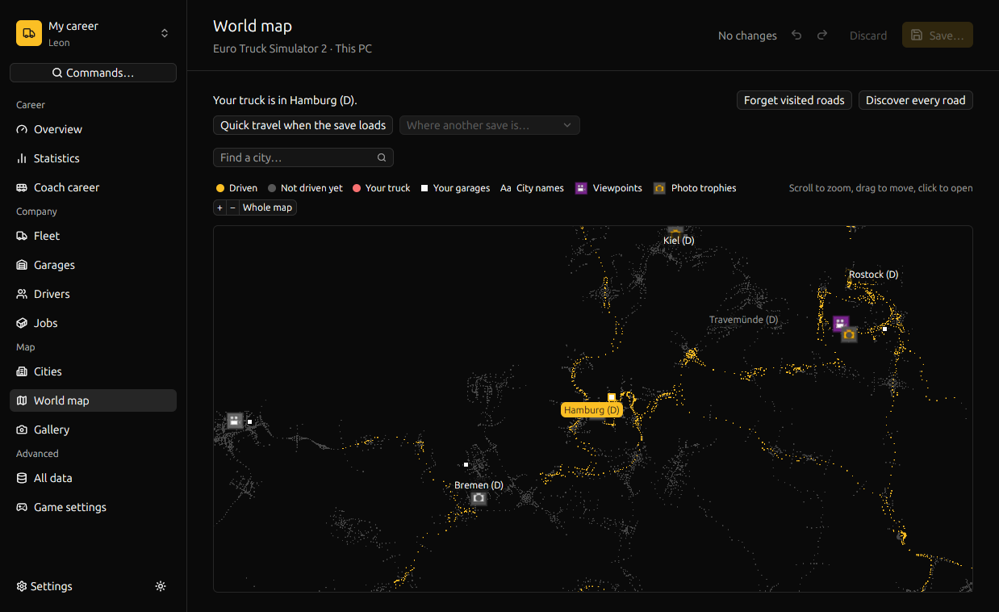
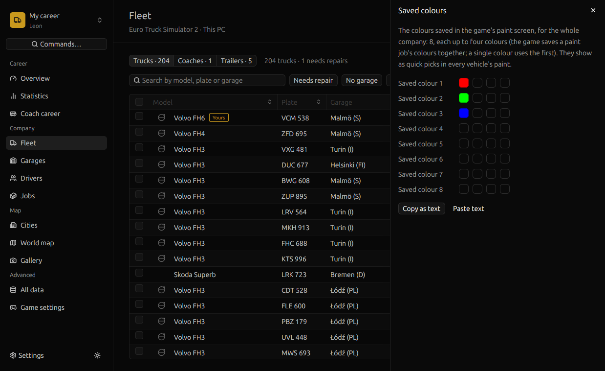
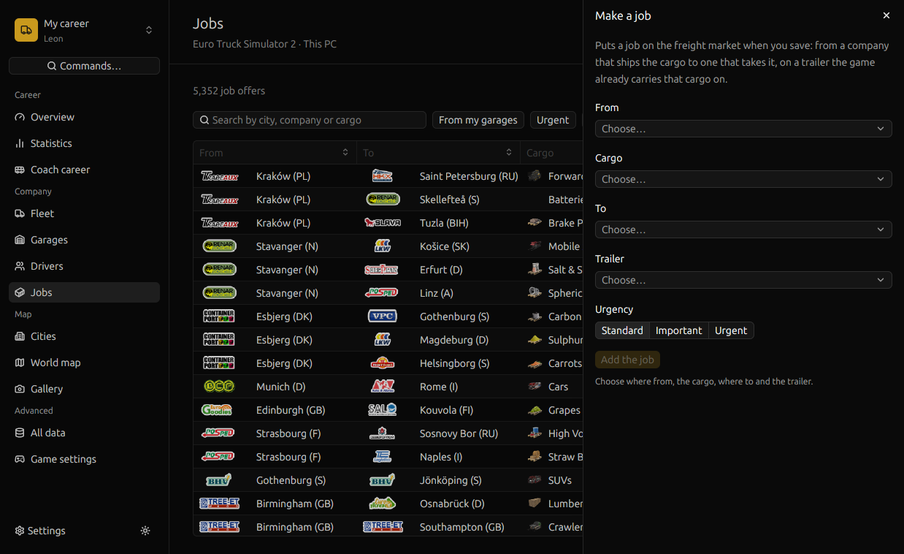

<!-- The notes for 0.3.0, to paste over the drafted ones when publishing v0.3.0. The download and
     checksum sections the workflow adds (.github/release-footer.md) follow them. The pictures are
     from scripts/screenshots.sh (a made-up demo profile); they're linked by the commit that adds them. -->

**Truck Save Editor 0.3.0** gives the coach career a page of its own, adds a Gallery of viewpoints and photo trophies, lets you repaint trucks and trailers, and puts jobs you make yourself on the freight market.

### New

- **Coach career**, a page of its own for saves with a coach career: coach experience and skills, the coach services as the game's statistics show them (set the passengers and the coach distance, make every passenger happy, discover every bus stop), and every coach service from the game's log.

  
- **Gallery**: every viewpoint and photo trophy in the game, what you've visited and captured, and what's left, with filters to find it. **Visit every viewpoint**, or mark one as visited or not found. Photo trophies are your own photos, so the editor only shows them.

  
- **Viewpoints and photo trophies on the map**, in the game's own icons: click one to open it.

  
- **Paint** in a truck's or trailer's panel: its paint job from the game's own list, and the colours the paint job lets you change. **Saved colours** (Fleet, or the palette) edits the colour sets saved in the game's paint screen, and copies them as text to share.

  
- **Make a job** (Jobs, or the palette): pick where from, the cargo, where to, the trailer and how urgent, and it's on the freight market when the save loads. The game plans the route itself, ferries included.

  

### Changed

- **The sidebar's Map group**: **Cities** (the list), **World map** and **Gallery**, each a page. **Show on map** in a city's, viewpoint's or photo trophy's panel opens World map there.
- **Every city**, small towns too, counted as the game's Career Progress counts them, and so are truck dealers.
- **Overview and Statistics** show the truck career; the coach career is on Coach career.
- **Paint jobs, engines and transmissions** are offered only from DLCs the save was made with, so nothing the game won't show turns up.
- Pages no longer have **Ctrl+1 … 9**: go to any page from the sidebar or the palette (Ctrl+K). Settings keeps Ctrl+,.

Found a problem? **Report a problem** in Settings → About (or on the error message) opens a GitHub issue filled in with what helps.
