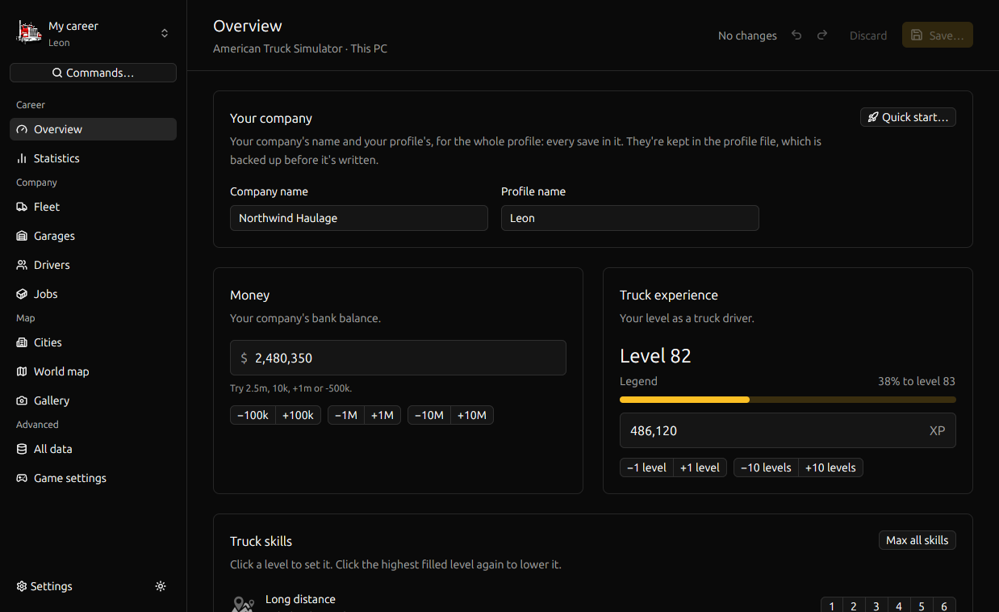
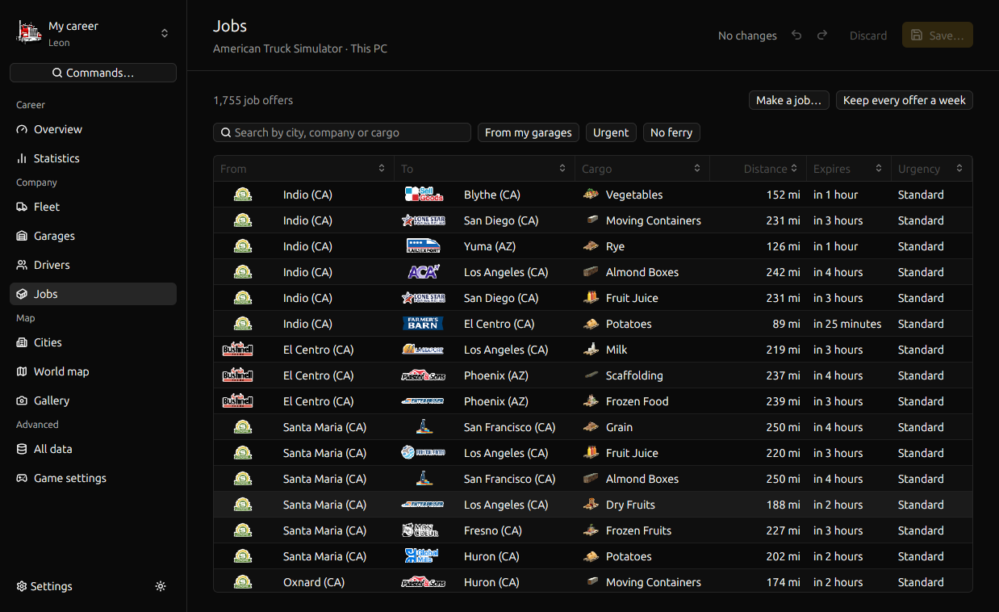
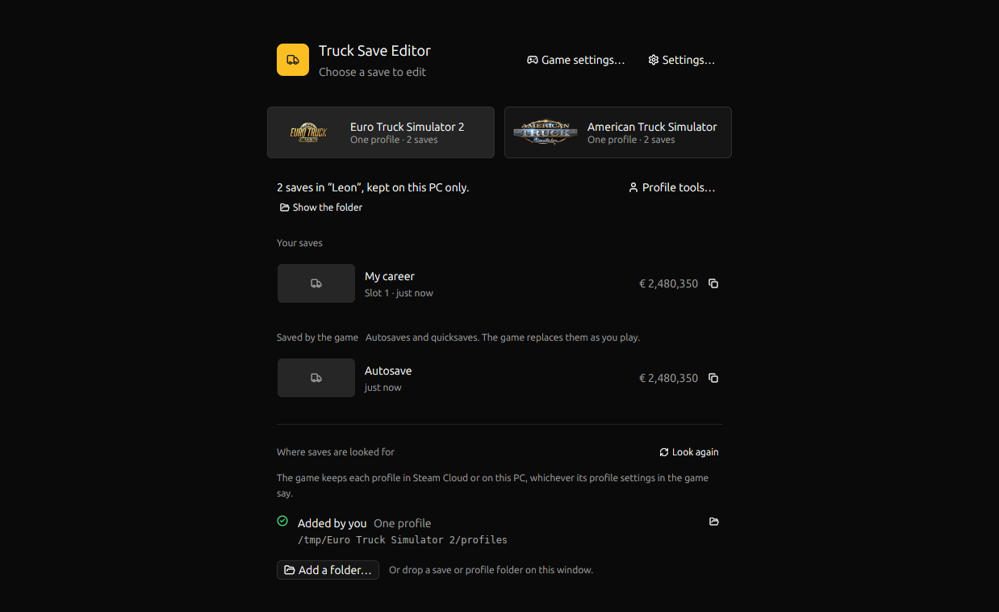

<!-- The notes for 0.4.0, to paste over the drafted ones when publishing v0.4.0. The download and
     checksum sections the workflow adds (.github/release-footer.md) follow them. The pictures are
     from scripts/screenshots.sh (a made-up demo profile); they're linked by the commit that adds them. -->

**Truck Save Editor 0.4.0** supports **American Truck Simulator**, and adds trucks, trailers and coaches to your company: ready-made from the game's dealers, or copied from your own.

### New

- **American Truck Simulator.** ATS saves open with ATS's own data: its map and cities with their states, truck dealers and recruitment agencies, companies, cargo and photo trophies, in miles, pounds and dollars, and in ATS's words (hazardous cargo, states). Every page reads the game the save is from.

  

  
- **Pick the game first** on the start screen, each with its own logo, then the profile. The open save's game shows by its icon beside the save's name, and in the window title.

  
- **Add a truck, a trailer or a coach** (Fleet, or the palette): any the game's dealers sell ready-made, for the DLCs your save was made with, into a garage with room (coaches join your coaches). A road train comes whole. Nothing is paid, and Undo takes it back.
- **Copy a truck, trailer or coach** from its panel: same parts, paint and wear.
- New trucks, trailers and coaches get **plates made the game's way**, in the format of their garage's country or state.
- **Duplicate a save** on the start screen (saves kept on this PC).
- Hovering a save's "2 hours ago" on the start screen shows **its exact date and time**.

### Fixed

- **Recruitment agencies** unlocked in the editor open in the game, and hiring online works. Before, they opened to a black screen. An agency unlocked with 0.3.0 is repaired the next time you save that save in the editor.
- **Garages** and **Buy all** leave out cities of map DLCs you don't have, and **World map** their roads, as the game does.
- **Long tooltips** wrap instead of running off the screen.

Found a problem? **Report a problem** in Settings → About (or on the error message) opens a GitHub issue filled in with what helps.
