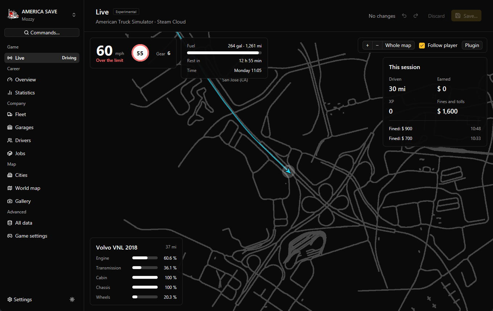
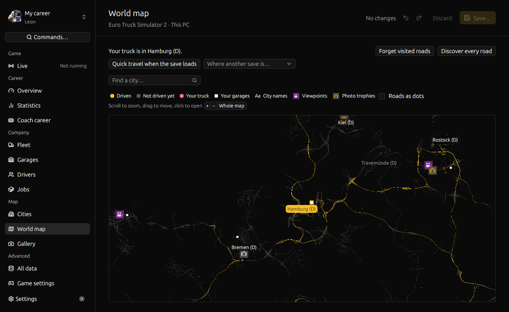

<!-- Headline: Live, and maps with real roads
     The notes for 0.5.0. The download and checksum sections the workflow adds
     (.github/release-footer.md) follow them. The recording was made in the game by the owner; the
     World map picture is from scripts/screenshots.sh (a made-up demo profile). Both are linked by
     the commit that adds them. -->

**Truck Save Editor 0.5.0** shows the game live while you play, and draws the map's roads as roads.

### New

- **Live (experimental).** While you drive, the editor shows where you are on the map and which way you're heading, with the road you've driven this session behind you and a flag on your job's destination. Over the map: your speed against the limit, gear, fuel and range, rest, the game's clock, your vehicle's wear, your job with what's left of it, and this session in totals (driven, earned, XP, fines and tolls) with what just happened. Both games, each in its own units.

  

  Live works through a small plugin for the game's own SDK. The Live page adds it to the game's folder in one click, and its Plugin menu removes it again at any time, also while the game is running. The plugin only reads, and nothing leaves your PC. The game asks you to confirm that it uses SDK features each time it starts with a plugin.

  Good to know: Live needs a save open in the editor, from the game that's running. The game reports only cargo jobs live, so a coach service is read from your newest save and updates when the game saves.
- **Maps draw roads as roads.** World map shows every road as the line it runs along, read from the game's own map files, where it used to show a dot for each. **Roads as dots** in the map's legend brings the old look back.

  

### Changed

- The window opens a little larger.

Found a problem? **Report a problem** in Settings → About (or on the error message) opens a GitHub issue filled in with what helps.
