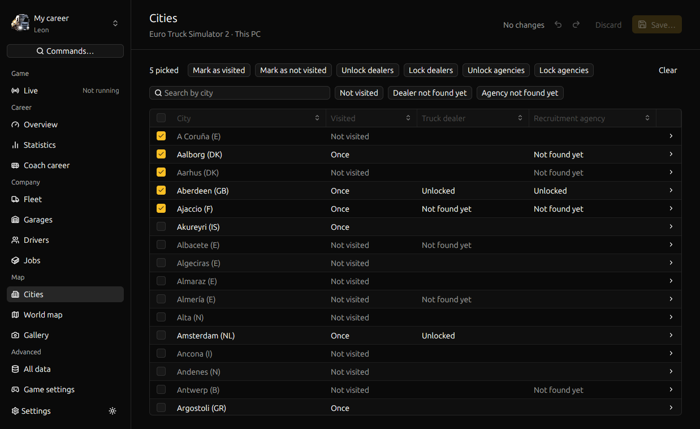
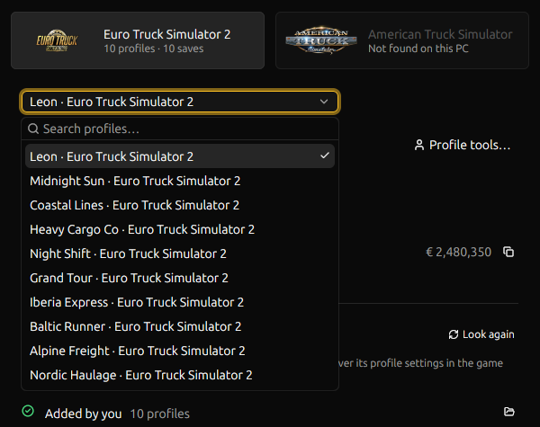

<!-- The notes for 0.5.1. The download and checksum sections the workflow adds
     (.github/release-footer.md) follow them. The pictures are from scripts/screenshots.sh
     (a made-up demo profile); they're linked by the commit that adds them. -->

### New

- **Change several cities or viewpoints at once.** Tick rows on Cities or Gallery, then mark them visited or not, or unlock or lock the cities' dealers and agencies. One Undo takes it back.

  
- **Cities and Gallery sort** by any column.
- **Search on the start screen**, for profiles and for saves, when there are many.

  

### Changed

- **A cleaner look**: pages no longer put every section in a box.

  
- A third click on a table heading removes the sort.

### Fixed

- With many profiles, the ones past the edge of the start screen couldn't be reached.
- A table's sort button sometimes did nothing.
- Saves briefly said they needed DLCs after switching games.

Found a problem? **Report a problem** in Settings → About (or on the error message) opens a GitHub issue filled in with what helps.
