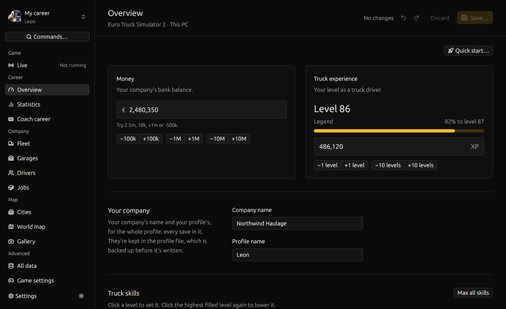

<!-- The notes for 0.5.1. The download and checksum sections the workflow adds
     (.github/release-footer.md) follow them. The pictures are from scripts/screenshots.sh
     (a made-up demo profile); they're linked by the commit that adds them. -->

**Truck Save Editor 0.5.1** changes several cities or viewpoints at once, gives the pages a calmer look, and makes the start screen work for players with many profiles and saves.

### New

- **Pick several cities or viewpoints and change them together.** Cities and Gallery have a checkbox on each row, and one in the heading for every row shown. With cities picked: mark them as visited or not visited, and unlock or lock their truck dealers and recruitment agencies. With viewpoints picked: mark them as visited or not found. Each is one change, and one step for Undo.

  
- **Cities and Gallery sort** by any column: click a heading.
- **Search your profiles.** With more than a few profiles of a game, the start screen lists them in a box you can search.
- **Search your saves.** A profile with more than a few saves gets a search above them on the start screen, by a save's name or its slot. A search also looks through every save the game made, not only the newest few.

### Changed

- **Pages without boxes.** Sections are told apart by their titles, space and a thin line, and each page leads with what matters most on it.

  
- **A third click on a table's heading takes the sort off**, back to the save's own order.

### Fixed

- **Profiles past the edge of the start screen couldn't be reached.** With many profiles, the row of them was cut off. Every profile is in the list now.
- A table's sort button sometimes did nothing when clicked.
- Saves no longer say they need DLCs for a moment after you switch games on the start screen.

Found a problem? **Report a problem** in Settings → About (or on the error message) opens a GitHub issue filled in with what helps.
